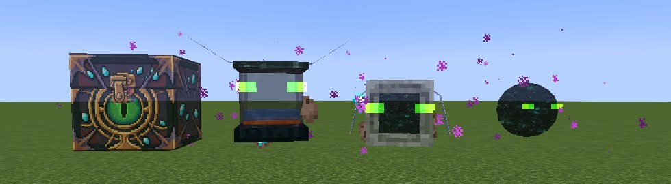

# Phantom Storage

Summonable, ghostly flying pets that carry your stuff, all called up with one item: the **Phantom Charm**. NeoForge 1.21.1.



**Full guide: [the wiki](https://github.com/hammerknife404/phantom_storage/wiki).** Downloads: [Releases](https://github.com/hammerknife404/phantom_storage/releases).

| Charm mode | What it does | Unlocked by |
|---|---|---|
| Chest | 108 slots of personal storage, a crafting grid, a void filter | Available from the start |
| Tank | 4 fluid tanks of 32 buckets, any fluid | *Local Brewery* |
| Anchor | A waypoint you teleport to, from any dimension; keeps its chunk loaded | *Remote Getaway* |
| Collector | Gathers dropped items and experience into your storage | *You've Got a Friend in Me* |
| Saddle | Ride and fly your Phantom Chest | *Great View From Up Here* |
| Gateway | A 15-second doorway to your anchor that anyone can walk through | *The End... Again...* |
| Bell | Summons or dismisses every pet at once | *Hot Tourist Destinations* |

## Quick start

**Recipe:** Phantom Membrane ×3 around an Ender Chest, Soul Campfire below, Gold Block in each corner.

| With the charm | |
|---|---|
| Sneak + scroll | Switch mode (locked modes are skipped) |
| Use | Summon that pet, or recall it if it's out |
| Sneak + use | Dismiss it |

| On a pet | |
|---|---|
| Right-click | Open its panel |
| Sneak + right-click | Stay / follow |

Your storage and tanks live on you, not on the pets, so they survive death, logout and dimension changes. Only the owner can use a pet, and only `/kill` can kill one.

## Requirements

- Minecraft 1.21.1, NeoForge 21.1.251+, on both client and server
- Optional: JEI or REI (recipe lookup, crafting-grid fill), [LambDynamicLights](https://modrinth.com/mod/lambdynamiclights)

## Build

```sh
./gradlew build          # jar in build/libs/, runs unit tests
./gradlew runClient      # dev client
```

Builds are versioned `X.Y.Z-dev` locally and `X.Y.Z-dev.<commit>` in CI; only the Release workflow produces a plain `X.Y.Z` jar, so a test build can't be mistaken for a release. JEI and REI are optional compile-only dependencies; uncomment the `localRuntime` line in `build.gradle` to run the dev client with JEI.

Docs: the wiki's source is [`docs/wiki/`](docs/wiki) (synced to the wiki on every change to `main`); the Modrinth description is [`docs/modrinth.md`](docs/modrinth.md). Notes for contributors and coding agents are in [`CLAUDE.md`](CLAUDE.md).
