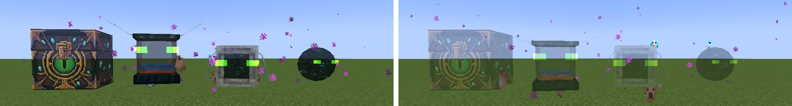

# Config

## Client config

Per player, in `config/phantomstorage-client.toml` or in-game under **Mods → Phantom Storage → Config**. Changes show at once.

| Option | Default | Does |
|---|---|---|
| Opacity: All pets | 100% | Multiplies the values below. Every part of a pet fades with it, eyes and End portal void included |
| Opacity: Phantom Chest | 80% | How see-through the chest is (10–100%) |
| Opacity: Phantom Tank | 80% | The tank's frame and wings; glass and fluid scale with it |
| Opacity: Phantom Anchor | 80% | The anchor's stone, wings and End portal windows, and the whole gateway |
| Opacity: Phantom Collector | 80% | The collector's End portal orb and its eyes |
| Glow: Phantom Chest / Tank / Anchor | on | Never render darker than light level 7; the anchor's setting also covers the gateway's frame (the eyes always glow, dimmed only by opacity) |

*All-pets opacity at 100% (left) and 40% (right), the per-pet values at their default 80%.*

Light cast onto surroundings comes from [LambDynamicLights](https://modrinth.com/mod/lambdynamiclights) and is toggled in its own settings.

## World config

Per world, in `serverconfig/phantomstorage-server.toml` inside the world folder, or in-game under **Mods → Phantom Storage → Config → World settings** (in single player, or as an operator on a server). The server sends it to every player, so everyone rides at the server's speed.

| Option | Default | Does |
|---|---|---|
| Phantom Saddle: Flight speed | 4 blocks/s | How fast the ridden chest flies (1–20; a player walks at 4.3) |
| Phantom Saddle: Allow sprinting | off | Sprinting while riding flies at the sprint speed |
| Phantom Saddle: Sprint speed | 5.4 blocks/s | Used only with sprinting allowed (1–30; a player sprints at 5.6) |
| Pets: Follow across dimensions | on | Following pets come along when you change dimension. Off, they're dismissed and summoned again with the charm |
