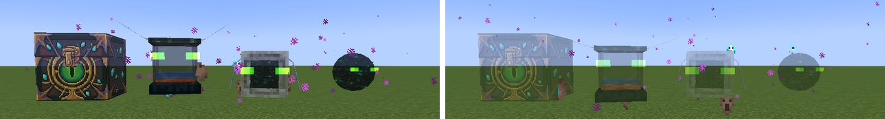

# Client Config

Per player, in `config/phantomstorage-client.toml` or in-game under **Mods → Phantom Storage → Config**. Changes show at once.

| Option | Default | Does |
|---|---|---|
| Opacity: All pets | 100% | Multiplies the values below. Every part of a pet fades with it, eyes and End portal void included |
| Opacity: Phantom Chest | 80% | How see-through the chest is (10–100%) |
| Opacity: Phantom Tank | 80% | The tank's frame and wings; glass and fluid scale with it |
| Opacity: Phantom Anchor | 80% | The anchor's stone, wings and End portal windows, and the whole gateway |
| Opacity: Phantom Collector | 80% | The collector's End portal orb and its eyes |
| Glow: Phantom Chest / Tank / Anchor | on | Never render darker than light level 7; the anchor's setting also covers the gateway's frame (the eyes always glow, dimmed only by opacity) |

*All-pets opacity at 100% (left) and 40% (right), the per-pet values at their default 80%.*

Light cast onto surroundings comes from [LambDynamicLights](https://modrinth.com/mod/lambdynamiclights) and is toggled in its own settings.
