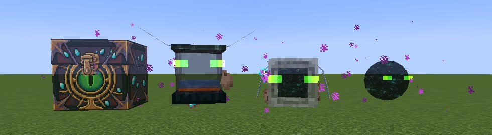
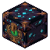
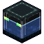
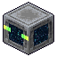
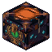
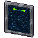

# Phantom Storage

Summonable, ghostly flying pets that carry your stuff, all called up with one item: the **Phantom Charm**. NeoForge 1.21.1, required on client and server.

| Charm mode | What it does | Unlocked by |
|---|---|---|
|  [Chest](Phantom-Chest) | 108 slots of personal storage, a crafting grid, a void filter | Available from the start |
|  [Tank](Phantom-Tank) | 4 fluid tanks of 32 buckets, any fluid | *Local Brewery* |
|  [Anchor](Phantom-Anchor) | A waypoint you teleport to, from any dimension; keeps its chunk loaded | *Remote Getaway* |
|  [Collector](Phantom-Collector) | Gathers dropped items and experience into your storage | *You've Got a Friend in Me* |
|  [Saddle](Phantom-Saddle) | Ride and fly your Phantom Chest | *Great View From Up Here* |
|  [Gateway](Phantom-Gateway) | A 15-second doorway to your anchor that anyone can walk through | *The End... Again...* |
|  [Bell](Phantom-Bell) | Summons or dismisses every pet at once | *Hot Tourist Destinations* |

Start with the [Phantom Charm](Phantom-Charm): the recipe, how to switch modes, and the unlocks. Things every pet shares (following, ownership, dimensions, light) are on [Pet Behavior](Pet-Behavior). Per-player look settings are under [Client Config](Client-Config); mod interplay and upgrading are under [Compatibility](Compatibility).
