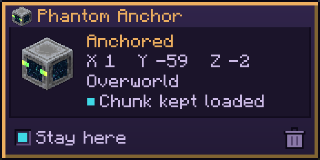

# Phantom Anchor

A waypoint you teleport to. Unlocked by *Remote Getaway*. A small ghostly lodestone whose sides are windows onto the void, the End portal's own starfield, with phantom wings and glowing eyes; anchored, it hangs still with its wings folded.

## Charm use (anchor mode)

| Anchor is | Use |
|---|---|
| Not out | Summon it |
| Following | Teleport to a safe spot within 3 blocks of it |
| Anchored (told to stay) | Teleport to a safe spot within 3 blocks of it, from anywhere, other dimensions included |
| Looked at (up to 32 blocks, through walls), either way | Swap places with it; an anchored anchor stays anchored where you stood |
| Sneak + use | Dismiss it, from anywhere |

A safe spot is solid ground you fit on, with nothing harmful in it or next to it (fire, lava, cactus, powder snow and the like) and no portal or cobweb; surface water if there's nothing else. If there's none, the charm says so and nothing happens.

## Anchored

Sneak + right-click it, or tick **Stay here** in its panel, and it's anchored:

- Its chunk stays loaded and ticking (farms, furnaces) while you're online. Nothing is loaded while you're offline.
- It stays put through your logouts, deaths, dimension changes and server restarts.
- It's where the [Phantom Gateway](Phantom-Gateway) leads.

Its panel shows where it is, its dimension and whether its chunk is kept loaded, with **Stay here** and a dismiss button. Dismissing it (or `/kill`) forgets its spot.
