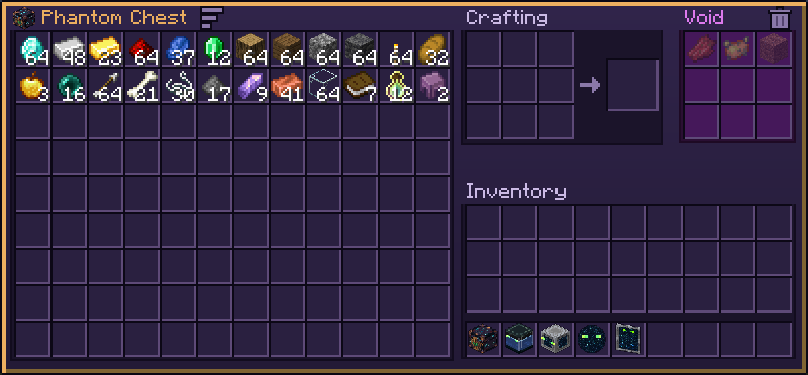

# Phantom Chest

A ghostly chest with 108 slots (12×9) of personal item storage, a 3×3 crafting grid and a void filter. Available from the start. Its storage lives on you, so it survives death, logout and dimension changes.

## Panel

| Icon | Does |
|---|---|
| Sort (bars, after the title) | Click: merge stacks and sort. Right-click or scroll: mode (Name, Amount, Mod). Shift + click: ascending / descending (the bars flip). Saved with your storage |
| Void grid | A filter of 9 ghost entries, saved with your storage: click a slot with an item to add it, empty-handed to clear it. Matching items your [collector](Phantom-Collector) picks up are destroyed instead of stored (matched by item, whatever its enchantments or name). What you pick up or move yourself is never touched |
| Trash (by the void grid) | Click while holding an item to destroy it |
| `+` (by the crafting output, JEI/REI only) | Opens crafting recipes; the viewer's own `+` fills the grid from storage and inventory |

Items left in the crafting grid go back to you when you close the panel.

The chest is also the mount for the [Phantom Saddle](Phantom-Saddle).
