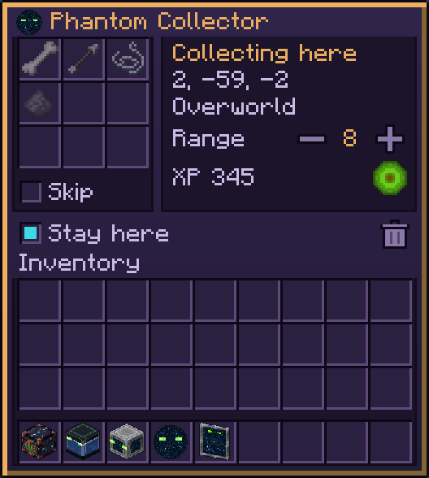

# Phantom Collector

Gathers dropped items and experience. Unlocked by *You've Got a Friend in Me*. A small orb of the End portal's starfield with glowing eyes; items it takes fly into it.

| Collector is | What it does |
|---|---|
| Following (default) | Picks up dropped items within its range of you (3–12 blocks, default 8). Experience orbs in range come to you, so Mending works as usual |
| Anchored (told to stay) | Picks up items within its range of its spot, wherever you are, other dimensions included; its chunk stays loaded and ticking while you're online. Experience goes into its bank; take it from its panel |

## Where items go

Into your [Phantom Chest](Phantom-Chest) storage, then your inventory; whatever fits nowhere stays on the ground. Items matching the chest's void filter are destroyed instead.

## What it takes

- Its own filter (9 ghost entries in its panel) lists what to take, or with **Skip** ticked, what to leave. Empty, it takes everything.
- It never takes items still on their pickup delay, items meant for someone else, or items an item-transport mod marked as not to be moved.
- Items you throw yourself lie 5 seconds first, so a quick toss to a friend or into a hopper still lands; anything you leave comes back.

## Panel

Filter and **Skip**, range (click or scroll), the experience bank with a take button, **Stay here**, and dismiss. Anchored, it keeps its spot through logouts, deaths, dimension changes and restarts, like the [anchor](Phantom-Anchor); the charm recalls it (same dimension) or dismisses it (anywhere).
