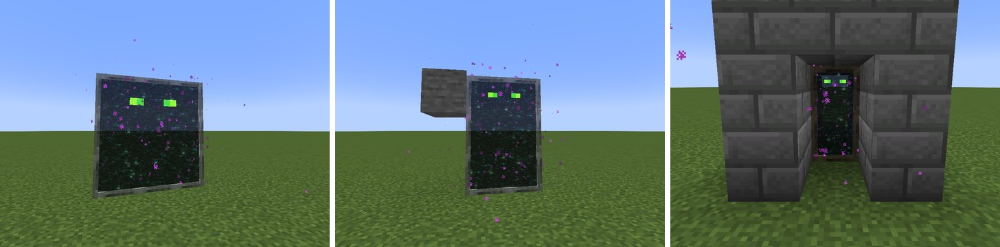
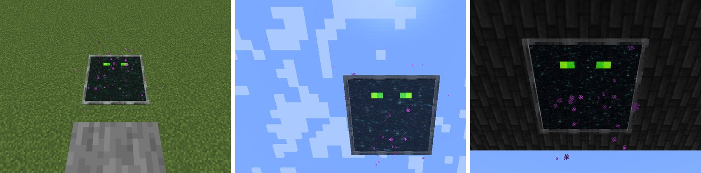

# Phantom Gateway

A short-lived doorway to your [Phantom Anchor](Phantom-Anchor) that anyone can walk through. Unlocked by *The End... Again...*.

| Charm use (gateway mode) | Result |
|---|---|
| Use | Open a gateway 2 blocks ahead of you (else 3), facing you and square to the block grid, for 15 seconds: 3 × 3 blocks, 2 × 3 where that doesn't fit, or 1 × 2 in a tunnel. Every block of the doorway must be clear. Needs your anchor anchored (told to stay) |
| Use, looking steeply down or up (50° or more) | Open it lying flat instead: on the floor where you look (under the ceiling, looking up), or, with nothing within 32 blocks, in mid-air 6 blocks along your look. 3 × 3, 2 × 2 or 1 × 1, whatever fits |
| Sneak + use | Close it |

*Standing: 3 × 3 in the open, 2 × 3 beside a block, 1 × 2 in a tunnel.*

*Lying flat: on the floor below a pillar, in mid-air above you, under a ceiling.*

## Going through

- Whatever steps into the doorway goes through: you, other players, mobs, items. Everyone lands on a safe spot within 3 blocks of the anchor, in whatever dimension it is (the same rules as anchor teleports), at rest: a fall or a flight ends there, with no fall damage.
- A flat gateway takes whatever stands on it, falls onto it or flies up into it, however fast: open one under a friend who's falling (or under the whole group), or above you while flying an elytra out of trouble.
- Pets don't go through themselves. Following pets catch up as usual; if you crossed to another dimension, they're summoned again beside you.
- Bosses, spectators, and anything riding something else (except you on your chest) stay out.

## Closing

After 15 seconds, on sneak + use, when you open another, when you log out, or when the anchor stops being anchored. One gateway per player.

It's a 3 × 3 block doorway (2 × 3 or 1 × 2 in tighter spots) of the End portal's starfield in a ghostly lodestone frame (the anchor's stone), the phantom eyes peering out of the void on both sides. It swells open and shrinks shut.
