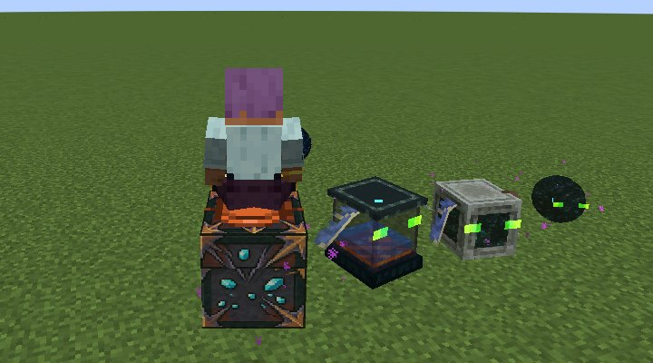

# Phantom Saddle

Ride and fly your [Phantom Chest](Phantom-Chest). Unlocked by *Great View From Up Here*. A charm mode with no entity of its own: the chest wears a saddle while you ride.

| Charm use (saddle mode) | Result |
|---|---|
| Use | Get on (the chest is summoned under you if it isn't out) |
| Use again, or sneak | Get off |
| Sneak + use | Dismiss the chest |

## Flying

| While riding | Does |
|---|---|
| Look + W / S | Fly forward or back along where you look, up and down included |
| A / D | Strafe |
| Space | Rise |
| No keys | Slows to a hover |

It flies at 4 blocks/s, a little slower than you walk (4.3), and sprinting doesn't speed it up: it is for getting round rough ground and building on cliff faces, not long trips or racing.

Ridden, the chest collides with blocks and keeps your head out of them, so you can't fly into walls or ceilings; two-block tunnels still fit. It takes no fall damage and passes none to you. It can't take portals with you aboard.
