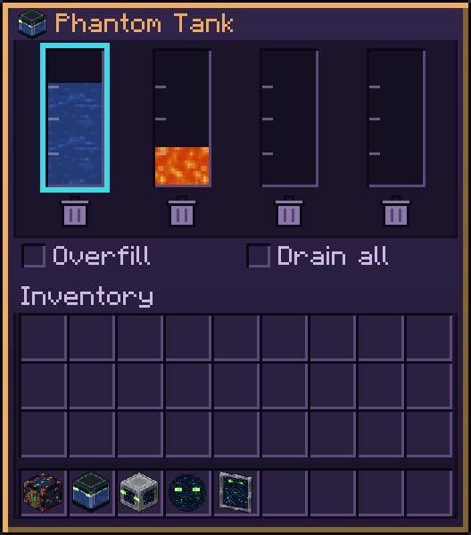

# Phantom Tank

Four fluid tanks of 32 buckets each, any fluid, modded ones included. Unlocked by *Local Brewery*. Tinted glass in a ghostly ender chest base and lid, with flapping phantom wings and glowing phantom eyes; every tank's fluid shows as a stacked layer inside, the active tank on top. It rings like amethyst when you open it.

## In the world

| Action | Result |
|---|---|
| Right-click with a bucket, bottle (water, 250 mB) or other fluid container | Pour into, or fill from, the active tank without opening the panel; the action bar shows that tank's level |
| Sneak + right-click holding a fluid container | Cycle the active tank |

## Panel

| Control | Does |
|---|---|
| Gauge, click with an empty cursor | Makes that the active tank (outlined) |
| Gauge, left-click with a filled container (bucket, water bottle, modded tank item) | Pours it into that tank |
| Gauge, right-click with an empty container | Fills it from that tank |
| Trash (under each gauge) | Destroys the fluid in that tank |
| **Overfill** (off by default) | Buckets on the tank: when the active tank is full or holds another fluid, pour into the next tank of that fluid or an empty one |
| **Drain all** (off by default) | Buckets on the tank: when the active tank is empty, keep drawing from the next tank until all are empty |
